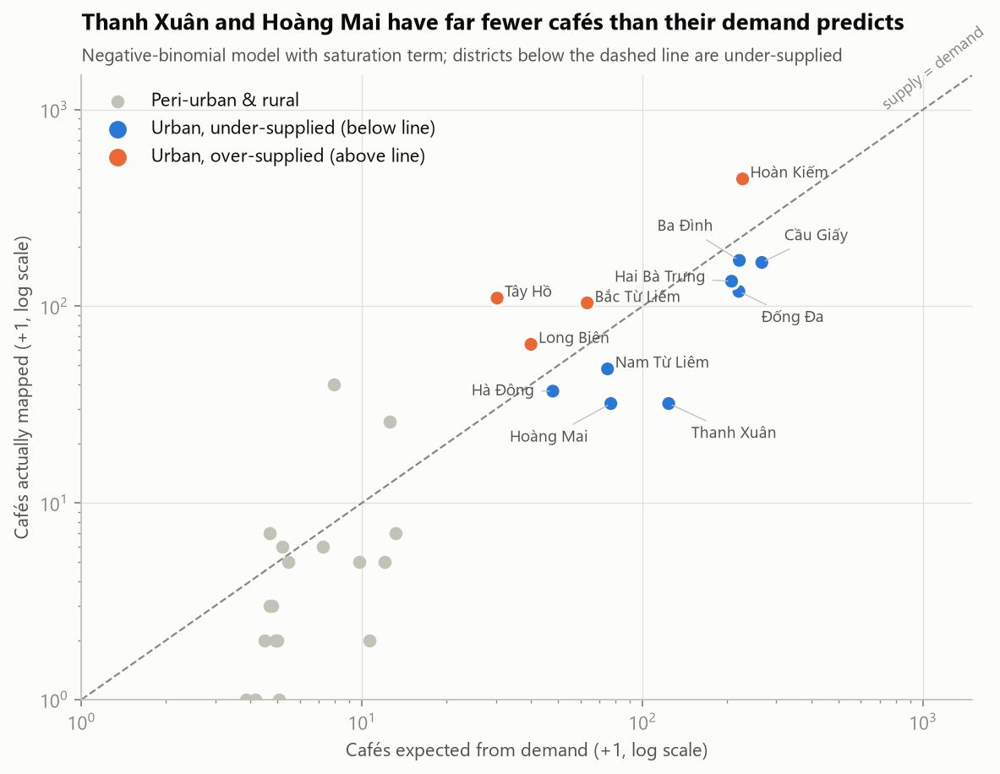
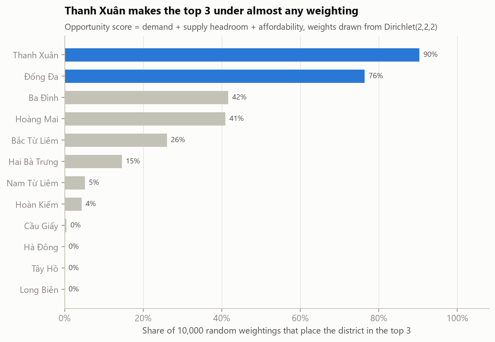
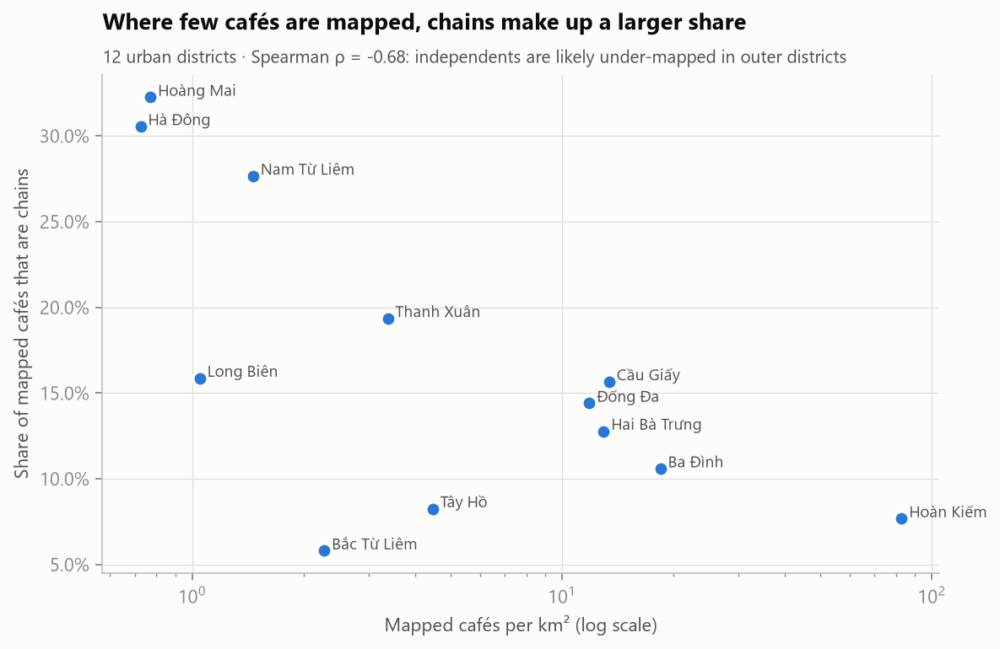
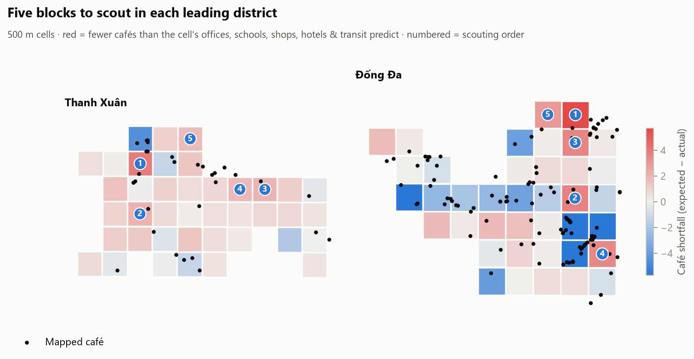

# Where should a café brand open next in Hanoi?

**A site-selection study across Hanoi's 30 former districts, built from public data with a reproducible pipeline.**

> **Recommendation:** open in **Thanh Xuân**, with **Đống Đa** as the lower-risk alternative. First run a one-day field
> count of the 5 shortlisted blocks; that count is the go/no-go test.

| | Finding |
|---|---|
| **Market is concentrated** | Hoàn Kiếm has **2 %** of Hanoi's 8.4 M residents but **28 %** of its mapped cafés. The 12 urban districts hold 45 % of residents and 93 % of cafés. |
| **One demand dimension** | Six footfall drivers (offices, schools, hotels, shops, transit stops, residential density) collapse into a single index that explains **93 %** of their variance. |
| **Supply saturates** | A negative-binomial model of café counts needs a significant saturation term. Without it, the model would wrongly call Hoàn Kiếm under-supplied. |
| **Biggest gap** | Thanh Xuân has **31 mapped cafés where its demand predicts ~123**, and chain cafés alone show the same gap (6 vs ~15). Land is ~20 % cheaper than in the other inner districts. |
| **Robust ranking** | Across 10,000 random scoring weightings, Thanh Xuân is **#1 in 80 %** and top 3 in 90 %. Đống Đa is top 3 in 76 % and #1 if the supply-gap signal is dropped. |
| **Avoid** | Hoàn Kiếm (saturated, 2.7–3.5× the land price) and Tây Hồ (priced ~2.8× what its footfall implies). |



---

## The analysis in six steps

| # | Question | Method | Notebook § |
|---|---|---|---|
| 1 | Can the data be trusted? | Cross-source validation (OSM vs official areas: 0.4 % median error), join coverage, **test for OSM mapping bias** | 2 |
| 2 | Where is café demand? | PCA demand index from six log-transformed density drivers | 4 |
| 3 | Where is supply short of demand? | Negative-binomial GLM with area offset; linear vs quadratic compared on AIC and **leave-one-out CV**; re-run on chain cafés as a robustness check | 5 |
| 4 | Is land cheap *for what it offers*? | Log-price regression on demand with HC3 robust errors; residuals as a premium/discount | 6 |
| 5 | What kinds of district exist? | K-means vs Ward clustering, silhouette, **bootstrap stability (ARI)** | 7 |
| 6 | Which district, and which blocks? | Screen → weighted score → **Monte-Carlo weight sensitivity** and leave-one-component-out; 500 m grid supply model for micro-location | 8–9 |

<table><tr>
<td></td>
<td></td>
</tr></table>



### What makes this more than a map of cafés

- **Bias measured, not ignored.** Among the urban districts, the chain share of mapped cafés falls as mapped café density
  rises (Spearman ρ = −0.68, p = 0.015). This suggests that OpenStreetMap misses small independents outside the centre. Supply
  is therefore always judged relative to OSM-derived demand, and every gap is re-estimated on chain cafés only.
- **Model choice is justified.** The quadratic saturation term wins on AIC (241 vs 247) and on out-of-sample error.
- **The weights are tested.** No single weighting is defended. The ranking is stress-tested across 10,000 Dirichlet draws,
  and the README states openly that Thanh Xuân's lead depends on the supply-gap component.
- **It ends in a decision.** The output is a ranked shortlist, 10 specific blocks, and a go/no-go rule for the field visit.

## Data

| Source | Content | Notes |
|---|---|---|
| [Wikipedia *Hanoi*, oldid 1292944335](https://en.wikipedia.org/w/index.php?oldid=1292944335) | Area and population of the 30 districts | Pinned to the last revision before the July 2025 administrative reform |
| [mogi.vn/gia-nha-dat](https://mogi.vn/gia-nha-dat) | Average asking land price per m² | 27 of 30 districts; snapshot date stored in `data/processed/prices.csv` |
| OpenStreetMap via Overpass, `date:"2025-01-01"` | District boundaries | A historical query, because the districts were abolished on 1 Jul 2025 |
| OpenStreetMap via Overpass | 15,484 POIs in 8 categories | © OpenStreetMap contributors, ODbL |

**Why former districts?** Vietnam replaced its district level with 126 wards/communes in Hanoi on 1 July 2025. Price and
population data are still published by former district, so that is the only unit where all sources line up.

## Repository layout

```
├── notebooks/hanoi_cafe_site_selection.ipynb   # the full analysis, executed
├── src/
│   ├── fetch_data.py       # step 1: download & cache raw data (polite retries, pinned sources)
│   ├── build_dataset.py    # step 2: spatial joins, features, 500 m grid
│   ├── common.py           # paths, HTTP helper, district-name normalisation
│   └── viz.py              # shared chart style
├── data/processed/         # tidy snapshots (committed, so results reproduce offline)
├── reports/figures/        # all charts
└── reports/micro_location_map.html             # interactive block map (Folium)
```

## Reproduce

```bash
python -m venv .venv && .venv/Scripts/activate      # macOS/Linux: source .venv/bin/activate
pip install -r requirements.txt
python src/fetch_data.py          # add --refresh to re-download; otherwise uses cache
python src/build_dataset.py
jupyter nbconvert --to notebook --execute --inplace notebooks/hanoi_cafe_site_selection.ipynb
```

`data/processed/` is committed, so the notebook runs without network access. Re-fetching will pick up newer OSM edits
and the latest mogi.vn prices, so the numbers can move slightly.

## Limitations

- OSM café coverage is uneven (mitigated, not eliminated; see §2.2 of the notebook).
- Land asking prices stand in for commercial rent.
- Population figures predate the 2025 reform (~2023 estimates).
- POI counts measure the presence of footfall drivers, not footfall itself.
- There is no revenue model: the study says *where*, not *how much*.

Notebook §11 lists how each limitation would be closed.
